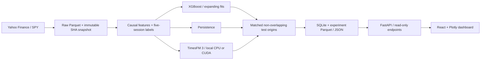

# Architecture and scientific protocol

## Information timing

A row at session t represents information available after that NYSE close. Returns
use vendor-adjusted closes. Displayed SPY market prices use the unadjusted close.
No missing price is interpolated or carried forward. Expected sessions come from
the exchange calendar, including holidays and early closes. An observation is
eligible for download only 20 minutes after its scheduled session close.

For log return r(t), trailing RV5(t) = sqrt(252/5 × sum(r(t-k)^2, k=0..4)).
Forward RV5(t) = sqrt(252/5 × sum(r(t+k)^2, k=1..5)). Thus the label at t is exactly
trailing RV5(t+5), not RV5(t+1), and the final five rows have no realized label.
TimesFM generates five trailing-volatility forecasts and supplies the fifth one as
the common target prediction. NYSE session dates, rather than business-day offsets,
align the latest forecast path. Intermediate TimesFM points forecast trailing RV;
only the fifth point has the full forward-five-session interpretation.

## Model information sets

Persistence uses the most recent observed RV5. TimesFM uses the last 256 finite RV5
observations with no fine-tuning. XGBoost uses trailing RV over 5/10/21/63 sessions,
lagged log returns, absolute returns, backward rolling averages, and price momentum.
Every input is known at the origin. Different information sets mean this is a model
workflow comparison, not a controlled equal-input ablation.

XGBoost sequentially adds small decision trees to correct prior prediction errors.
It is trained on observed features and matured forward-volatility labels. TimesFM
is a pretrained time-series foundation model used zero-shot on volatility history.
Its official implementation is installed from a pinned Git commit; its Hugging Face
checkpoint is pinned to a resolved revision and cached within ignored `data/`.

## Splits and label purging

- Initial training history: 2015–2021.
- Validation origins: 2022–2023. Any validation label ending in 2024 is excluded.
- Test origins: 2024 onward, every fifth session, with fully observed targets.
- Three candidate XGBoost parameter sets are compared on validation MAE only.
- Expanding fits are refreshed every 20 origins (100 sessions by default).
- A training row is included only when its target_end <= the refit origin.
- At an origin's close, returns through that close are observable, so a label
  ending on that origin is eligible. Its future forecasting target begins next session.
- Past validation and test labels can enter later expanding fits once matured.
  The test window is untouched for hyperparameter selection, not frozen out of
  subsequent causal training. No test error chooses parameters or thresholds.
- The optional quick run uses the last 40 test origins for **every** available model.
  It is labeled as a limited evaluation, not equivalent to the full test window.

Regimes use RV5 at the origin versus its expanding historical median, with a
63-observation warmup. Regimes are never assigned from future volatility.

## Evaluation and interpretation

All available models share target values and origins. Metrics are MAE, RMSE,
signed bias, MAE improvement over persistence on paired origins, and prediction
latency. Volatility is stored in decimal units; UI errors are percentage points.
TimesFM batch wall time is amortized per origin and excludes model loading, as do
baseline prediction latencies. Training times are not comparable inference costs.

Negative predictions are clipped at zero; raw endpoint predictions, raw MAE, and
clipped counts are retained. Model quantiles are uncalibrated and describe trailing
RV at each horizon; they are not a promise of confidence or risk coverage.

This is a retrospective historical study of a model released in 2026. Its financial
pretraining overlap is unknown, so the test period is not demonstrably unseen by
the pretrained model. The provider's adjusted historical data can also be revised.
Immutable local raw snapshots, SHA-256 fingerprints, source and checkpoint revisions,
configs, seeds, and dependency versions make each local experiment traceable.

## Persistence and API

SQLite stores complete experiments and predictions in one transaction. Parquet/JSON
exports are written per run ID. The API never loads a large model; it reads saved
results. A model failure is captured in metadata, and the remaining models continue.
The UI renders explicit setup/unavailable states instead of invented statistics.

`/api/status`, `/api/market`, `/api/volatility`, `/api/research`, `/api/forecasts`,
`/api/performance`, `/api/backtests`, `/api/models`, `/api/runs`; OpenAPI at `/docs`.
Date ranges are inclusive and invalid ranges return 422. Missing market data returns
503; missing experiments return 404. The server binds only to `127.0.0.1` by default.

## Tests and boundaries

Unit tests use deterministic synthetic price fixtures, strictly within tests. They
verify mathematical identities, causal feature invariance, matured training labels,
non-overlapping target windows, holidays/early closes, metrics, model failure, SQLite
transactions, HTTP validation, and explicit nulls. Mocked TimesFM adapter tests are
separate from an opt-in genuine checkpoint integration test on downloaded SPY data.
Frontend tests mock API responses and Plotly rendering; browser QA checks the real
API/dashboard and actual charts. No unit fixture is exposed through the application.
